 

 

## Sobre mim

Sou estudante de **Análise e Desenvolvimento de Sistemas** e desenvolvedor web em formação, com foco em **Front-end**. Gosto de entender como as coisas funcionam por trás de cada interface e de transformar o que aprendo em projetos reais, publicados e versionados aqui no GitHub.

Trabalho com **HTML5**, **CSS3** e **JavaScript**, e estou me aprofundando em lógica de programação e construção de interfaces. Meu objetivo é contribuir com projetos reais e evoluir constantemente como profissional.

| | |
|---|---|
| **Foco** | Desenvolvimento web e Front-end |
| **Stack atual** | HTML5 · CSS3 · JavaScript |
| **Estudando** | TypeScript · Python · lógica de programação |
| **Formação** | Análise e Desenvolvimento de Sistemas (início em 2026) |
| **Procuro** | Estágio ou vaga júnior em desenvolvimento Front-end |

 

## Tecnologias

  

  <b>Ferramentas</b> 
  

 

## Projetos

  
  
  

 

## Atividade

  

  

 

## Jornada

- **2026**: início da graduação em Análise e Desenvolvimento de Sistemas.
- **2026**: desenvolvimento de projetos próprios e aprofundamento em tecnologias web.
- **Próximos passos**: evoluir em JavaScript, estudar TypeScript e Python e construir aplicações cada vez mais completas.

 

> Disciplina para aprender. Curiosidade para explorar. Código para transformar ideias em realidade.

 

### Vamos trocar uma ideia?

[LinkedIn](https://www.linkedin.com/in/SEU-USUARIO) • [E-mail](mailto:kaiquesilva231999@gmail.com) • [GitHub](https://github.com/kaiquecyber)

Os gráficos desta página são gerados automaticamente a partir dos meus dados reais do GitHub, todo dia.

