# Olá, eu sou Kaique Silva 👋

### Transformar ideias em códigos que funcionam.

**Estudante de Análise e Desenvolvimento de Sistemas | Desenvolvedor Web em formação**

  

Eu sou o sol, minhas linguagens são os planetas e meus projetos, as luas.

---

## 🧑‍💻 Sobre mim

Olá! Sou o Kaique, estudante de **Análise e Desenvolvimento de Sistemas**, construindo minha trajetória na área de tecnologia, com foco atual em desenvolvimento web e Front-end.

Tenho conhecimentos em **HTML5** e **CSS3** e estou me aprofundando em meus estudos em **JavaScript**, buscando transformar o aprendizado em projetos práticos.

Gosto de entender como as coisas funcionam por trás de cada interface, explorar novas possibilidades e desenvolver soluções que tenham propósito.

Meu objetivo é crescer como desenvolvedor, contribuir com projetos reais e evoluir constantemente como profissional.

---

## 🛠️ Tecnologias e ferramentas

**Desenvolvimento Web**

**Ferramentas**

**Atualmente estudando:** JavaScript, lógica de programação e desenvolvimento de interfaces web.

**Próximos objetivos:** TypeScript e Python.

---

## 🚀 Projetos em destaque

  
  
  

---

## 📊 Atividade

  

---

## 🌱 Minha jornada

- **2026** — Início da graduação em Análise e Desenvolvimento de Sistemas.
- **2026** — Desenvolvimento de projetos próprios e aprofundamento em tecnologias web.
- **Próximos passos** — Evoluir em JavaScript, estudar TypeScript e Python e construir aplicações cada vez mais completas.

---

## 📌 Minha filosofia

> Disciplina para aprender. Curiosidade para explorar. Código para transformar ideias em realidade.

---

### Vamos trocar uma ideia?
